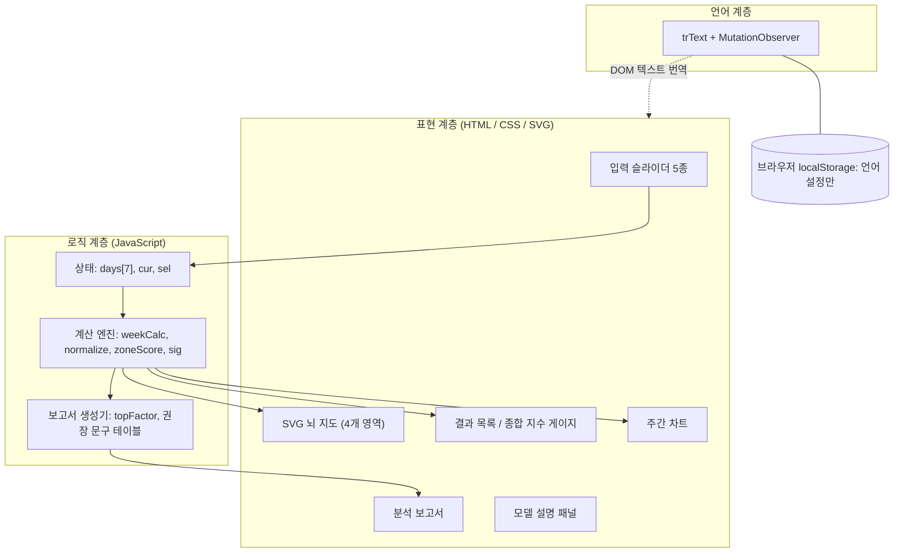
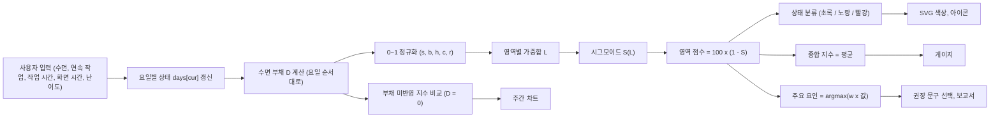
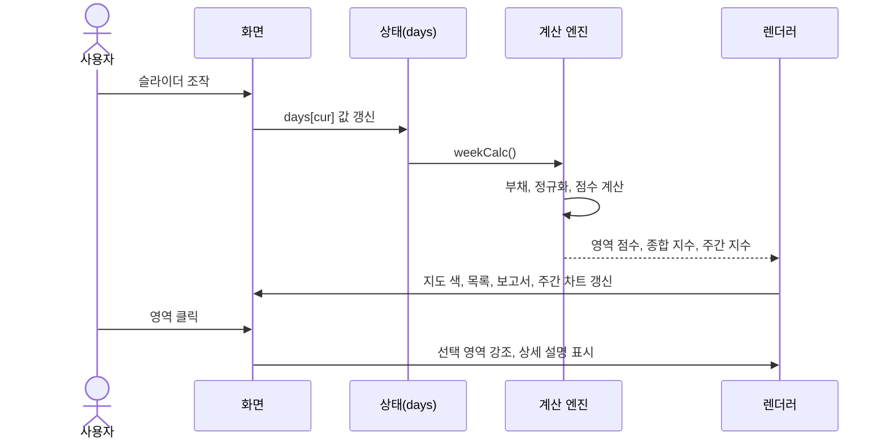
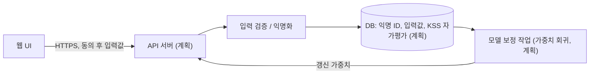

# NeuroFocus 시스템 아키텍처

| 항목 | 내용 |
|---|---|
| 목적 | 구조, 데이터 파이프라인, 설계 결정을 기록한다 |
| 대상 | 정적 웹 프로토타입 (`index.html`) |
| 관련 문서 | [README](../README.md), [기능명세서](기능명세서.md), [개발일지](개발일지.md) |

## 1. 설계 원칙

1. **클라이언트 전용:** 서버와 DB 없이 브라우저에서 모든 계산을 수행한다. 개인 건강 데이터를 외부로 보내지 않는다.
2. **투명성:** 모든 수식, 가중치, 출처를 화면에서 확인할 수 있다. 블랙박스 모델을 쓰지 않는다.
3. **관심사 분리:** 계산(순수 함수) / 화면 렌더링 / 언어 전환 계층을 나눈다.
4. **정직한 한계 표시:** 가정과 검증 여부를 문서와 화면에 명시한다.

## 2. 구성 요소



## 3. 데이터 파이프라인



각 단계의 정의:

| 단계 | 함수 | 입력 → 출력 |
|---|---|---|
| 수면 부채 | `weekCalc()` | 7일 입력 → 요일별 D (`D_n = max(0, 0.7·D_(n-1) + (8 − 수면))`) |
| 정규화 | `normalize(v)` | 입력 + D → `{s, b, h, c, r}` (각 0~1) |
| 영역 점수 | `zoneScore(w, x)` | 가중치, 정규화값 → 정수 0~100 |
| 시그모이드 | `sig(L)` | 0~1 → 0~1 (k = 8, 중심 0.5, 양 끝 정규화) |
| 상태 분류 | `status(score)` | 점수 → `ok` / `warn` / `bad` |
| 주요 요인 | `topFactor(w, x)` | 가중치, 정규화값 → 기여가 가장 큰 요인 |
| 화면 갱신 | `update()` | 상태 → DOM, SVG, 차트 갱신 |

## 4. 사용자 상호작용 순서



## 5. 인터페이스, 백엔드, DB 구성

### 5.1 현재 구성 (구현)
| 계층 | 현재 상태 |
|---|---|
| 인터페이스 | 있음. 단일 HTML 안의 CSS와 SVG |
| 백엔드(서버) | **없음** |
| 데이터베이스 | **없음** |
| 영속 저장 | 언어 설정만 `localStorage`에 저장 |
| 외부 요청 | Google Fonts 글꼴만 로딩 (실패 시 시스템 글꼴 사용) |

서버와 DB를 두지 않은 이유는 설계 결정 ADR-01을 참고한다.

### 5.2 확장 설계 (미구현, 계획)
검증 연구와 개인화를 위해 서버를 추가한다면 다음 구조를 생각한다. 아직 구현하지 않았다.



설계 시 고려할 점: 개인 식별 정보 분리, 최소 수집, 동의 철회, 개인정보 보호법과 연구윤리 심의(IRB) 준수.

## 6. 데이터 모델

```text
Day            { slp: 수면(시간), blk: 연속작업(분), hrs: 작업(시간), scr: 화면(시간), cog: 난이도(0-10) }
Normalized     { s, b, h, c, r }                       각 0~1
ZoneResult     { score: 0~100, top: 's'|'b'|'h'|'c'|'r' }
WeekResult     { res[7]: {영역: ZoneResult}, avg[7], base[7], debts[7] }
               avg: 부채 반영 종합 지수, base: 부채 미반영 종합 지수
```

## 7. 상태 관리와 렌더링

- 상태는 모듈 수준 변수(`days`, `cur`, `sel`)이다. 입력 이벤트마다 `update()`를 호출해 전체 화면을 다시 그린다(단순성 우선, 데이터 규모가 작음).
- 색 전환은 CSS `transition`, 지수 숫자는 `requestAnimationFrame` 보간, 게이지는 CSS `@property`로 처리한다.
- 언어 전환은 원본(러시아어) 텍스트 노드를 보관하고 사전(`KO` 배열)으로 번역하는 계층이다. `MutationObserver`가 동적으로 다시 그린 노드도 자동 번역한다.

## 8. 보안과 개인정보

| 항목 | 내용 |
|---|---|
| 수집 데이터 | 없음 (입력값은 메모리에만 존재) |
| 저장 데이터 | 언어 설정 1건(`localStorage`) |
| 외부 전송 | 없음 |
| 위협 | 사용자 입력은 숫자 슬라이더로 제한되어 주입 위험이 낮다. 번역 사전과 문구는 정적 문자열이다 |

## 9. 테스트 전략

| 구분 | 내용 | 상태 |
|---|---|---|
| 정적 검사 | Node.js로 스크립트 문법 검사 | 수행 |
| 번역 누락 검사 | 모든 러시아어 문자열이 번역 후 키릴 문자를 남기지 않는지 스크립트로 점검 | 수행 |
| 수동 계산 | 프리셋 3종의 영역 점수를 수식으로 직접 계산해 화면과 대조 | 수행 |
| 단위 테스트 | `normalize`, `zoneScore`, `sig`, `weekCalc`의 경계값 테스트 | 계획 |
| 브라우저 테스트 | DOM 기반 자동 테스트 (개발 환경에서 라이브러리 설치가 막혀 수행하지 못함) | 계획 |
| 사용성 평가 | 사용자 평가 | 계획 |

## 10. 배포

정적 파일 하나이므로 GitHub Pages 또는 임의의 정적 호스팅에 그대로 올릴 수 있다. 빌드 과정이 없다.

## 11. 설계 결정 기록 (ADR)

| ID | 결정 | 이유 | 대안과 한계 |
|---|---|---|---|
| ADR-01 | 서버·DB 없는 클라이언트 전용 구조 | 건강 관련 입력의 외부 전송 방지, 단순한 배포, 짧은 개발 기간 | 데이터 축적과 모델 보정이 불가능 (5.2 확장 설계) |
| ADR-02 | 머신러닝 대신 규칙 기반 가중 모델 | 학습 데이터가 없고, 투명성과 설명 가능성이 목표 | 예측력 검증이 어렵다. 데이터 확보 후 회귀로 대체 가능 |
| ADR-03 | 입력을 원인 변수로 한정 (피로, 오류율 제외) | 결과를 입력하면 같은 현상을 두 번 세게 되고, 오류율은 사용자가 알기 어렵다 | 주관적 피로와의 비교는 검증 단계(KSS)에서 수행 |
| ADR-04 | 시그모이드 변환 | 낮은 부하에서는 보상, 중간에서 급락, 높은 부하에서 포화하는 비선형 반응 표현 | 형태와 k 값은 가정이며 데이터로 맞추지 않음 |
| ADR-05 | 수면 부채 누적 모델 (이월 0.7, 최대 6시간) | 만성 수면 제한의 누적 효과를 단순하게 표현 | 계수는 가정값 |
| ADR-06 | 단일 HTML 파일 | 빌드 없이 실행, 발표·제출이 간단 | 규모가 커지면 모듈 분리가 필요 |
| ADR-07 | 런타임 DOM 번역 + 언어 전환 버튼 | 원본을 유지하고 두 언어를 오가며 상태를 보존 | 번역 사전을 직접 유지해야 하고 누락 위험이 있다 (번역 누락 검사로 보완) |
| ADR-08 | 보고서는 규칙 기반 문구 선택 | 외부 API 불필요, 결과 재현 가능 | 문구가 정형화되고 임상적 근거는 아님 (예시 문구로 고지) |
| ADR-09 | 색과 함께 아이콘·문구 표시 | 색각 이상 사용자 고려 | — |

## 12. 한계와 향후 과제

- 가중치와 계수는 가정이며 검증되지 않았다 (검증 계획은 README 8장).
- 외부 기기 연동과 서버는 구현하지 않았다.
- 향후: 단위 테스트 추가, KSS 자가평가 비교 기능, 사용자 평가, 데이터 기반 가중치 보정.
